# Entity–Relationship Diagram

The diagram below is derived from the real Dexie schema in
`src/db/schema.ts`. Entity names are shown in `SCREAMING_SNAKE` form, matching
the convention used in the specification. Every entity corresponds to an actual
table object on the `ErpDatabase` class, and the cardinalities reflect the real
key fields (for example `Invoice.partyId`, `Allocation.invoiceId` and
`Voucher.reversalOf`).

Two points to note about the real schema that differ from the starting diagram
in section 13 of the specification:

1. The specification drew separate `RECEIPT` and `PAYMENT` tables. In the
   implementation there is only **`VOUCHER`**: a receipt is a `VOUCHER` row with
   `type = 'RECEIPT'` and a payment is a `VOUCHER` row with `type = 'PAYMENT'`.
2. The specification drew `RECEIPT_ALLOCATION` and `PAYMENT_ALLOCATION`. In the
   implementation both are the single **`ALLOCATION`** table, which points at one
   invoice and one voucher.

```mermaid
erDiagram
    COMPANY {
        string id PK
        string name
        string gstin
        string pan
        string state
        int financialYearStartMonth
    }

    ACCOUNT {
        string id PK
        string code
        string name
        string type
        string parentId FK
        boolean isControl
        string normalBalance
        string partyType
        string partyId FK
    }

    CUSTOMER {
        string id PK
        string code
        string name
        string gstin
        string state
        int creditLimit
        int creditDays
        string ledgerAccountId FK
    }

    SUPPLIER {
        string id PK
        string code
        string name
        string gstin
        string state
        int paymentTermsDays
        string ledgerAccountId FK
    }

    ITEM {
        string id PK
        string sku
        string name
        string hsn
        string kind "GOODS | SERVICE"
        int gstRate
        string uom
        int purchasePrice
        int salePrice
        int reorderLevel
    }

    EMPLOYEE {
        string id PK
        string code
        string name
        string designation
        int basic
        int hra
        int allowances
        boolean pfApplicable
        boolean ptApplicable
    }

    ATTENDANCE {
        string id PK
        string employeeId FK
        string month
        int daysPresent
        int daysInMonth
    }

    PURCHASE_REQUISITION {
        string id PK
        string number
        string date
        string department
        string status
    }

    PURCHASE_REQUISITION_LINE {
        string id PK
        string prId FK
        string itemId FK
        number qty
        int estimatedRate
    }

    PURCHASE_ORDER {
        string id PK
        string number
        string date
        string supplierId FK
        string prId FK
        string status
    }

    PURCHASE_ORDER_LINE {
        string id PK
        string poId FK
        string itemId FK
        number qty
        int rate
        int gstRate
    }

    GRN {
        string id PK
        string number
        string date
        string poId FK
        string supplierId FK
        string status
    }

    GRN_LINE {
        string id PK
        string grnId FK
        string poLineId FK
        string itemId FK
        number receivedQty
        number acceptedQty
        number rejectedQty
        int rate
    }

    SALES_ORDER {
        string id PK
        string number
        string date
        string customerId FK
        string status
    }

    SALES_ORDER_LINE {
        string id PK
        string soId FK
        string itemId FK
        number qty
        int rate
        int gstRate
    }

    DELIVERY {
        string id PK
        string number
        string date
        string soId FK
        string customerId FK
        string status
        string invoiceId FK
    }

    DELIVERY_LINE {
        string id PK
        string deliveryId FK
        string soLineId FK
        string itemId FK
        number qty
        int rate
        int costRate
    }

    INVOICE {
        string id PK
        string type
        string number
        string partyInvoiceNumber
        string partyId FK
        string date
        string dueDate
        boolean interState
        int taxable
        int cgst
        int sgst
        int igst
        int total
        string status
        string sourceDocId FK
        string voucherId FK
    }

    INVOICE_LINE {
        string id PK
        string invoiceId FK
        string itemId FK
        string hsn
        number qty
        int rate
        int gstRate
        int taxable
        int cgst
        int sgst
        int igst
    }

    VOUCHER {
        string id PK
        string type
        string number
        string date
        string narration
        string status
        int amount
        string preparedBy FK
        string approvedBy FK
        string reversalOf FK
        string refDocId FK
        string partyId FK
    }

    LEDGER_ENTRY {
        string id PK
        string voucherId FK
        string date
        string accountId FK
        int debit
        int credit
        string partyId FK
        string narration
    }

    ALLOCATION {
        string id PK
        string invoiceId FK
        string voucherId FK
        string partyId FK
        int amount
    }

    STOCK_MOVEMENT {
        string id PK
        string itemId FK
        string date
        string type
        number qtyIn
        number qtyOut
        int rate
        string refDocId FK
    }

    PAYROLL_RUN {
        string id PK
        string month
        string status
        int grossTotal
        int pfTotal
        int ptTotal
        int tdsTotal
        int netTotal
        string voucherId FK
    }

    PAYSLIP {
        string id PK
        string runId FK
        string employeeId FK
        string month
        int gross
        int pf
        int pt
        int tds
        int otherDeductions
        int net
    }

    FIXED_ASSET {
        string id PK
        string code
        string name
        int cost
        string purchaseDate
        int usefulLifeYears
        string method
        int openingAccumulatedDep
        string assetAccountId FK
    }

    DEPRECIATION_ENTRY {
        string id PK
        string assetId FK
        string date
        string periodKey
        int amount
        string voucherId FK
    }

    USER {
        string id PK
        string username
        string name
        string passwordHash
        string salt
        string role
        boolean active
    }

    AUDIT_LOG {
        string id PK
        int ts
        string userId FK
        string username
        string action
        string entity
        string entityId
    }

    SEQUENCE {
        string key PK
        string prefix
        string fyKey
        int next
        int width
    }

    PERIOD_LOCK {
        string id PK
        string period
        string type
        string lockedBy FK
    }

    SETTING {
        string key PK
        string value
    }

    CUSTOMER ||--|| ACCOUNT : "has_sub_ledger"
    SUPPLIER ||--|| ACCOUNT : "has_sub_ledger"
    ACCOUNT ||--o{ ACCOUNT : "parent_of"
    ACCOUNT ||--o{ LEDGER_ENTRY : "is_posted_to"
    FIXED_ASSET ||--|| ACCOUNT : "capitalised_in"

    CUSTOMER ||--o{ SALES_ORDER : "places"
    CUSTOMER ||--o{ DELIVERY : "receives"
    CUSTOMER ||--o{ INVOICE : "is_billed_on"
    CUSTOMER ||--o{ ALLOCATION : "settles"

    SUPPLIER ||--o{ PURCHASE_ORDER : "receives"
    SUPPLIER ||--o{ GRN : "delivers"
    SUPPLIER ||--o{ INVOICE : "issues"
    SUPPLIER ||--o{ ALLOCATION : "settles"

    PURCHASE_REQUISITION ||--o{ PURCHASE_REQUISITION_LINE : "contains"
    PURCHASE_REQUISITION ||--o{ PURCHASE_ORDER : "converts_to"
    PURCHASE_ORDER ||--o{ PURCHASE_ORDER_LINE : "contains"
    PURCHASE_ORDER ||--o{ GRN : "received_via"
    PURCHASE_ORDER ||--o{ INVOICE : "billed_in"
    GRN ||--o{ GRN_LINE : "contains"

    SALES_ORDER ||--o{ SALES_ORDER_LINE : "contains"
    SALES_ORDER ||--o{ DELIVERY : "fulfilled_by"
    SALES_ORDER ||--o{ INVOICE : "billed_in"
    DELIVERY ||--o{ DELIVERY_LINE : "contains"
    DELIVERY ||--o| INVOICE : "invoiced_by"

    ITEM ||--o{ STOCK_MOVEMENT : "moves"
    ITEM ||--o{ PURCHASE_ORDER_LINE : "ordered_on"
    ITEM ||--o{ SALES_ORDER_LINE : "ordered_on"
    ITEM ||--o{ INVOICE_LINE : "billed_on"
    ITEM ||--o{ DELIVERY_LINE : "delivered_on"

    INVOICE ||--o{ INVOICE_LINE : "contains"
    INVOICE ||--o{ ALLOCATION : "settled_by"
    INVOICE ||--o| VOUCHER : "generates"

    VOUCHER ||--o{ LEDGER_ENTRY : "posts"
    VOUCHER ||--o{ ALLOCATION : "allocates"
    VOUCHER ||--o| VOUCHER : "reverses"

    PAYROLL_RUN ||--o{ PAYSLIP : "contains"
    PAYROLL_RUN ||--o| VOUCHER : "journals_to"
    EMPLOYEE ||--o{ ATTENDANCE : "has"
    EMPLOYEE ||--o{ PAYSLIP : "earns"

    FIXED_ASSET ||--o{ DEPRECIATION_ENTRY : "depreciated_by"
    DEPRECIATION_ENTRY ||--o| VOUCHER : "generates"

    USER ||--o{ AUDIT_LOG : "performs"
    USER ||--o{ VOUCHER : "prepares"
    USER ||--o{ PERIOD_LOCK : "locks"
```

## The three relationships that matter most

### (a) Every accounting document generates a voucher

Orders, requisitions, goods receipt notes and deliveries are *operational*
documents: they move stock and evidence a commitment, but they do not touch the
books. The moment a transaction becomes an accounting event — a purchase or sales
invoice, a receipt, a payment, a contra, a credit or debit note, a payroll run, a
depreciation run — it produces exactly one row in the `VOUCHER` table. Several
document tables hold the `voucherId` back-reference for this reason:
`INVOICE.voucherId`, `PAYROLL_RUN.voucherId` and `DEPRECIATION_ENTRY.voucherId`.
The voucher is the hinge between the operational world and the general ledger.

### (b) A voucher posts many ledger entries

Each voucher posts one or more rows into `LEDGER_ENTRY`. A single-line-per-side
receipt posts two rows (one debit, one credit); a GST invoice posts five or more.
The ledger rows are created only inside `createVoucher` in
`src/services/ledger.ts`, which calls `assertBalanced` first, so the debit total
of a voucher's rows always equals its credit total. Ledger rows are append-only:
they are never updated or deleted, only reversed by posting a mirror voucher.

### (c) Each customer and supplier is a sub-ledger under a control account

The chart of accounts has two control accounts — `1003` Accounts Receivable and
`2001` Accounts Payable (`isControl = true`). Every customer record carries a
`ledgerAccountId` that points at a dedicated sub-ledger account beneath `1003`,
and every supplier gets one beneath `2001`. The parent link is stored in
`ACCOUNT.parentId`, which is why `ACCOUNT` carries the self-relationship
`parent_of`. Party statements are produced by filtering `LEDGER_ENTRY` rows on
`partyId`, while the control account and all of its sub-ledgers roll up together
in the trial balance and balance sheet (see `rollupNet` in
`src/reports/core.ts`). A receipt credits the customer's sub-ledger; a payment
debits the supplier's sub-ledger; the control account is never posted to
directly.
