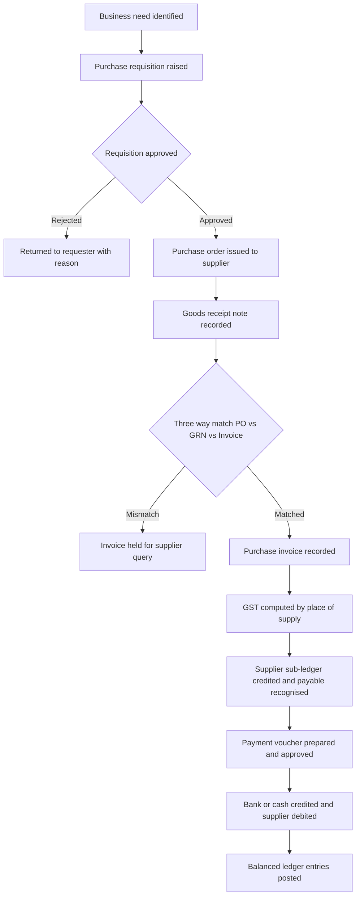
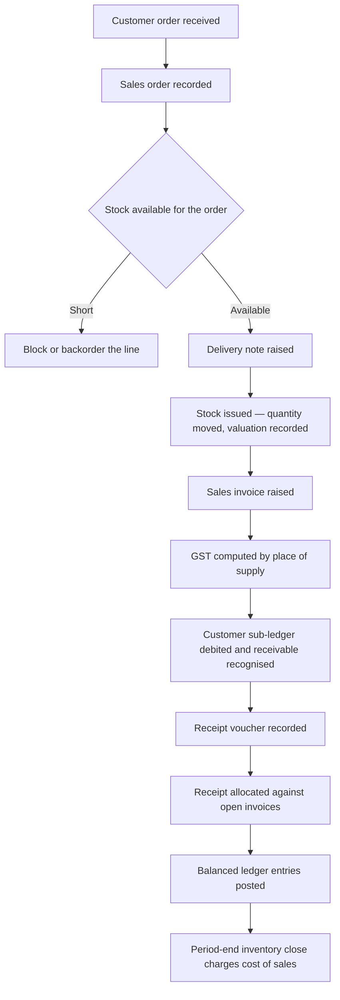
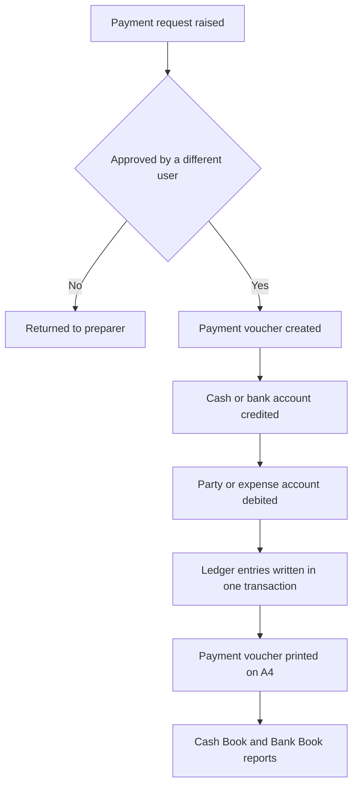
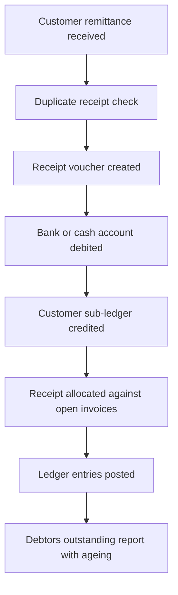
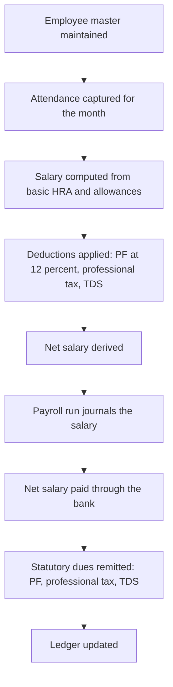
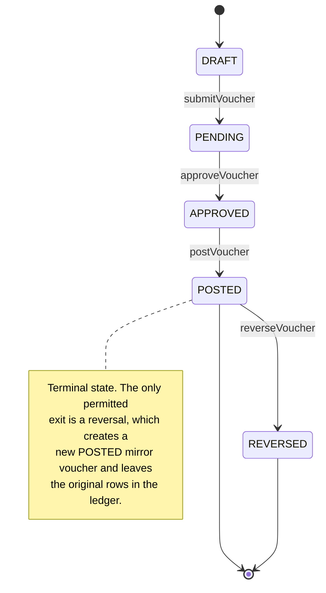

# Transaction Pathways and Voucher Lifecycle

This document describes the five core transaction pathways of the accounting ERP
and the voucher state machine. The pathways follow section 8 of the architecture
specification. Where a control is enforced in code, the enforcing module is named
so the reader can trace the rule to its implementation.

Each pathway is drawn as a Mermaid `flowchart TD`. Node labels contain no
parentheses or special characters so the diagrams render reliably.

---

## 1. Purchase Pathway

**Controls at each step.** Requisition and order creation are separated from
approval by the role matrix in `src/services/auth.ts` — the `PURCHASE_OFFICER`
role holds `purchase.create` but never `purchase.approve`, so the person who
raises demand cannot release it. The three-way match is supported by the snapshot
quantities held on `GrnLine` (`orderedQty`, `receivedQty`, `rejectedQty`,
`acceptedQty`), and only `acceptedQty` is allowed to enter stock, so goods that
fail inspection never inflate inventory. A supplier invoice number can never be
entered twice for the same supplier because the `invoices` table carries the
unique compound index `&[type+partyId+partyInvoiceNumber]`, and the payment step
is guarded by `assertMakerChecker` and `canApproveAmount` in
`src/services/controls.ts`. Every resulting posting is written through
`createVoucher` in `src/services/ledger.ts`, which calls `assertBalanced` before a
single ledger row is stored and refuses any posting into a locked period.

---

## 2. Sales Pathway

**Controls at each step.** Availability is computed from the stock movements
service, which never stores an on-hand figure — `replayMovements` and
`valueIssue` in `src/services/inventory.ts` recompute quantity and weighted
average cost from the movement history. The issue leaves a `costRate` on the
delivery line, captured at the moment of despatch, which the period-end close
uses to value the closing stock. Under the periodic method the cost of sales is
recognised once per period by `postInventoryClosing` (opening stock + purchases −
closing stock), not delivery by delivery. GST is
resolved by `isInterState` and `computeInvoiceGst` in `src/engine/gst.ts`, and the
receivable is posted to the customer's own sub-ledger beneath control account
`1003`. Receipts are recorded through `postReceipt` and tied to the invoices they
settle through the `allocations` table, while `looksLikeDuplicateReceipt` warns
the operator when the same party, amount and date have already been captured.

**Goods and services.** The pathway above is the *goods* path. A **service** sale skips the order,
availability check and delivery entirely: it is billed straight off a tax invoice with
`createSalesInvoice` (an invoice may be raised with no source delivery), and its taxable value is
credited to Service Income (`4003`) instead of Sales (`4001`). Services therefore never touch
`stockMovements`, which keeps the warehouse position meaningful.

---

## 3. Cash Payment Pathway

**Controls at each step.** Approval enforces both segregation rules at once:
`assertMakerChecker` stops the preparer from approving their own voucher, and
`canApproveAmount` refuses an `APPROVER` above the ₹25,000 threshold defined by
`APPROVAL_THRESHOLD` in `src/services/controls.ts`, routing larger payments to
the Finance Head (`ADMIN`). A payment raised through the **request** pathway is
parked as a PENDING voucher and its intended settlement is held in a plan; no
ledger entry is written until the request is released. `releaseSettlement` in
`src/services/cashbank.ts` approves, posts and applies the plan in a single
transaction, so the ledger entry and the settlement of the supplier invoices
commit together or not at all. The voucher receives a gapless number from
`allocateSequence` in `src/engine/numbering.ts`, which is only correct because it
is called inside a Dexie transaction. The posting itself is written by
`createVoucher`, which rejects an unbalanced voucher with `assertBalanced` and
blocks back-dated entries into a closed period. Every action also appends an
audit row through `writeAudit` in `src/services/audit.ts`.

---

## 4. Cash Receipt Pathway

**Controls at each step.** `looksLikeDuplicateReceipt` in
`src/services/controls.ts` compares the candidate party, amount and date against
existing receipts and warns the operator before a likely duplicate is saved — a
soft control, because a genuine second payment on the same day is possible. The
receipt is posted by `postReceipt` (Dr Bank or Cash, Cr customer sub-ledger) and
linked to the invoices it settles through the `allocations` table
(`invoiceId`, `voucherId`, `partyId`, `amount`), which lets the outstanding
report age each unpaid balance. As with every other pathway, the ledger rows are
only written once `assertBalanced` has confirmed that total debits equal total
credits.

---

## 5. Payroll Pathway

**Controls at each step.** The payroll posting function `postPayroll` in
`src/engine/posting.ts` recomputes the take-home figure itself and throws unless
`net = gross − pfEmployee − pt − tds − otherDeductions`, so a payslip that does
not reconcile can never reach the ledger. The `payrollRuns` table carries the
unique index `&month`, which makes it impossible to run the same month twice and
double-count salary. The employee's own PF contribution and the company's
matching employer PF are posted separately (Dr `5004` Salaries, Dr `5005`
Employer PF, Cr `2007` PF Payable), and attendance for the month is stored per
employee with the compound index `[employeeId+month]`. The salary payment
(`postSalaryPayment`) and statutory remittances (`postStatutoryPayment`) are
ordinary balanced vouchers, so they pass through the same approval, numbering and
audit controls as every other entry.

---

## 6. Voucher Lifecycle

A voucher moves through a fixed set of states. `POSTED` is a terminal state: once
a voucher has written ledger rows, the only permitted change is a reversal, and
reversal creates a *new mirror voucher* rather than editing the original. This is
what keeps the ledger append-only.

**Notes on the states.** The transitions are implemented in
`src/services/ledger.ts`: `submitVoucher` (DRAFT → PENDING), `approveVoucher`
(PENDING → APPROVED, enforcing maker-checker and the approval limit),
`postVoucher` (APPROVED → POSTED, writing the stashed lines in one transaction)
and `reverseVoucher` (POSTED → REVERSED, generating the mirror voucher via
`reverseLines`). `postVoucher` explicitly refuses to move a DRAFT, PENDING or
already REVERSED voucher, so the state machine cannot be short-circuited from the
UI. A document that is safe to recognise immediately — for example a receipt
confirmed at the counter — may also be created directly in the `POSTED` state by
`createVoucher`; in that case the intermediate states are simply skipped and the
audit row records an action of `POST`.
